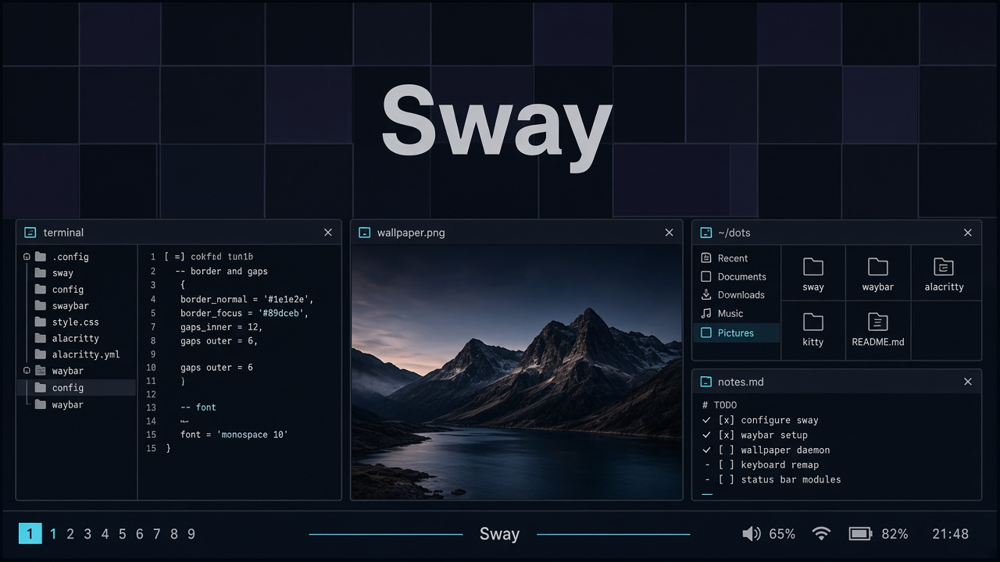

<h1 align="center">Config Sway</h1>

<p align="center">
  
</p>

<p align="center">Dotfiles de Sway con atajos al estilo Hyprland.</p>

Waybar, Rofi y temas. `./.config/` y `./home/` son lo que se copia al sistema. La referencia de atajos está en [fravelz.github.io/WEB-Hyprdots](https://fravelz.github.io/WEB-Hyprdots/).

<p align="center">
  <a href="LICENSE"></a>
</p>

<p align="center">
  <a href="https://skillicons.dev">
    <picture>
      <source media="(prefers-color-scheme: dark)" srcset="https://skillicons.dev/icons?i=linux,bash&theme=dark&perline=6">
      <source media="(prefers-color-scheme: light)" srcset="https://skillicons.dev/icons?i=linux,bash&theme=light&perline=6">
      
    </picture>
  </a>
</p>

## Características

- Sway, Waybar, Rofi y temas con wallpaper.
- Licencia Apache-2.0.
- `install.sh` deja el escritorio, SDDM y el login en Sway.

> [!NOTE]
> En un Arch vacío el script pide sudo, red y git. No lo ejecutes como root.

## Tecnologías

- **Sway** — el compositor.
- **Bash** — `install.sh` y `update.sh`.
- **Temas** — colores y fondo en `./.config/themes/`.

## Inicio rápido

```bash
./install.sh
```

> [!IMPORTANT]
> Tras `./install.sh` hay que reiniciar y entrar por SDDM a la sesión Sway.

## Uso

Flags útiles: `--no-sddm`, `--no-yay`, `--no-omz`, `--no-calc`. `--memory` añade earlyoom y zram.

> [!TIP]
> `update.sh` vuelve a sincronizar cuando el repo ya está aplicado.

## Contribuir

> [!CAUTION]
> `install.sh` instala paquetes y cambia el login. En una máquina que ya usas, mira las flags antes.

Repositorio de [Fravelz Setup](https://github.com/Fravelz-Setup).

## Licencia

Apache-2.0. El texto está en [LICENSE](LICENSE).

## Documentación

Notas de memoria del escritorio: [docs/estabilidad-memoria.md](docs/estabilidad-memoria.md).
